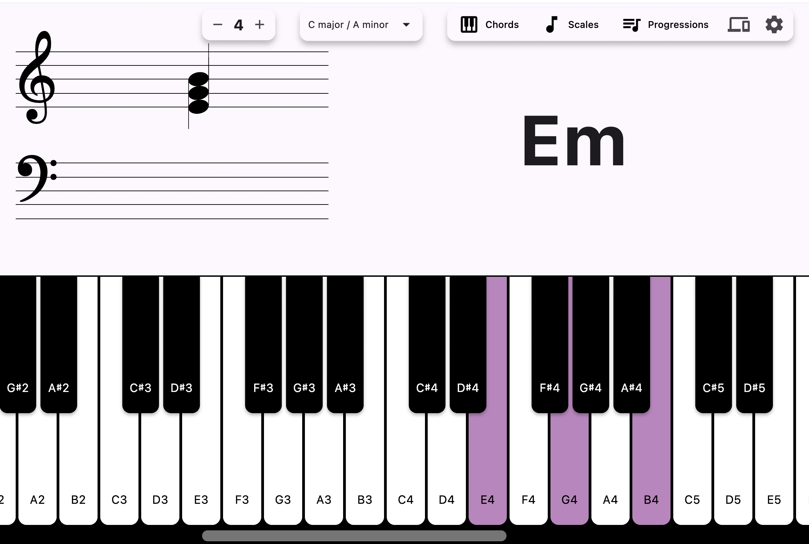
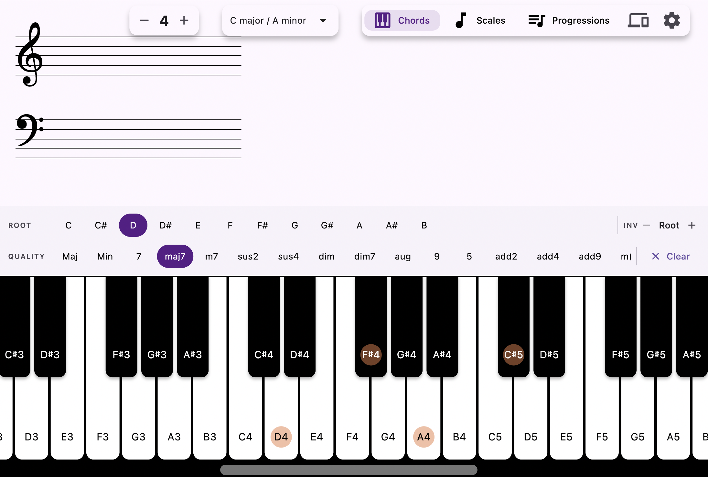
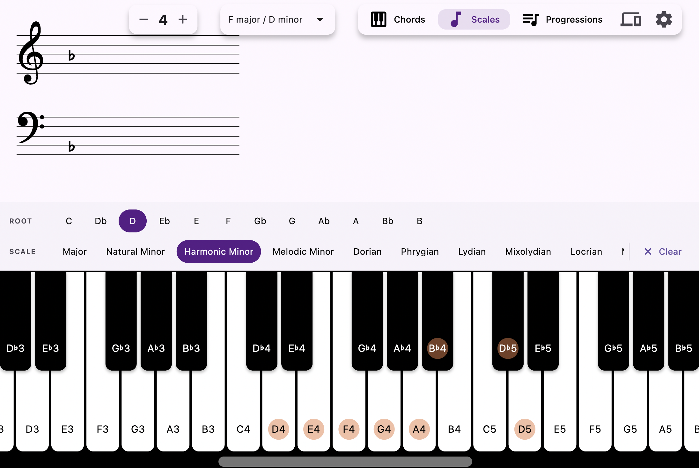
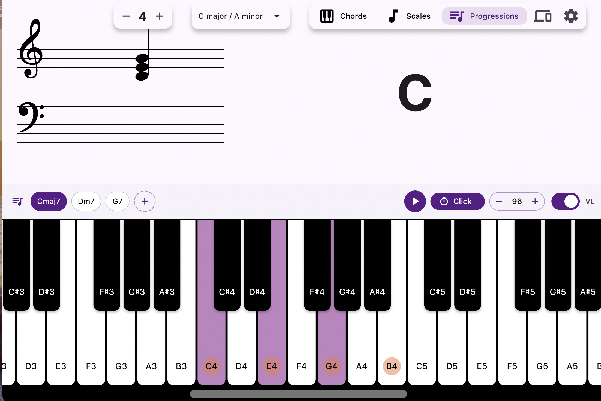
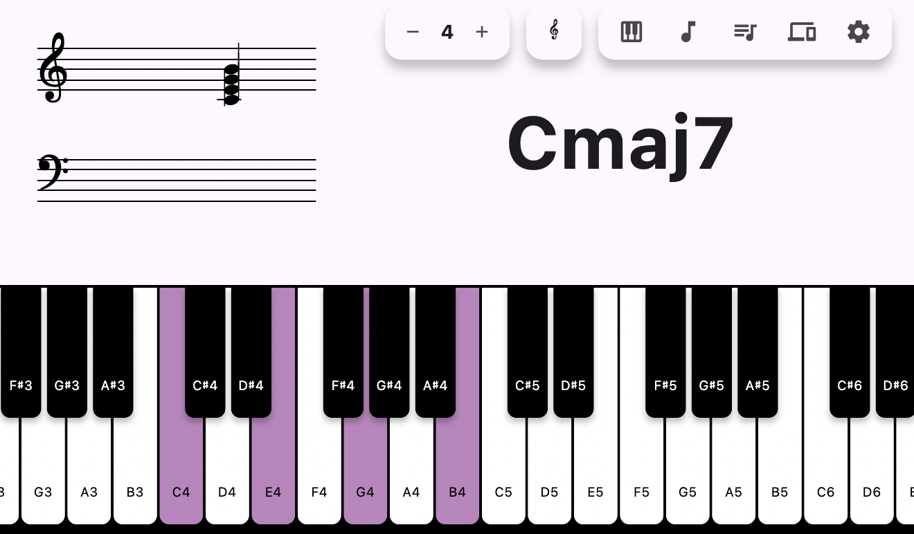
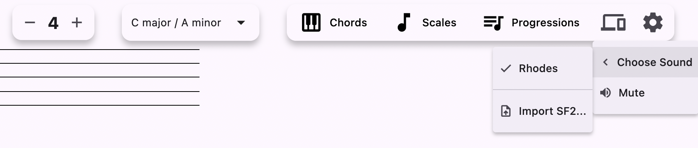

<p align="center">
  
</p>

<h1 align="center">ChordLens 🎹</h1>

<p align="center">
  A Flutter piano app with real time chord detection,
  MIDI input support and a playable keyboard.<br/>
  Fully supported on macOS, Windows and Android.
</p>

## Downloads

Website: **https://erezlavi.github.io/ChordLens/** 

[](https://github.com/ErezLavi/ChordLens/releases/latest)
[](https://github.com/ErezLavi/ChordLens/releases/latest)
[](https://github.com/ErezLavi/ChordLens/releases/latest)


## Features

- Chord detection with a chord name display
- Grand staff view of currently pressed notes
- Chord and scales highlighting from the top-right menu
- Chord progressions with playback, metronome click, adjustable BPM and voice leading
- Hardware MIDI input support (auto-connects to the first available device) / Playing from the computer's keyboard
- SoundFont playback via SF2 assets / uploaded custom SF2 files + mute mode

| Main Layout |
| --- |
|  |

| Chords | Scales |
| --- | --- |
|  |  |

| Progressions |
| --- |
|  |

| Mobile | Menu |
| --- | --- |
|  |  |

## Controls

- Computer keyboard mapping:
  - `Z S X D C V G B H N J M , L . ; /`
  - `[` and `]` to shift the keyboard octave

## Chord Progressions

Open **Progressions** from the top-right menu to build and play a sequence of chords.

- Tap `+` to add a chord, tap a chord to select it, and tap it again (or long-press) to change or remove it
- Press play to loop the progression, one chord per bar (needs at least 2 chords), with an optional metronome **Click**
- Adjust the tempo with `-` / `+` (40–240 BPM)
- Turn on **VL** (voice leading) for smooth transitions between chords

## SoundFonts

The app uses SoundFont files for instrument sounds. The default soundfont is set in
`lib/common/constants.dart` (`rhodesSoundFontAsset`). But you can upload your own SoundFont files and use them in the app.

## Getting Started

1. Install a Flutter SDK compatible with Dart 3.9.
2. Clone the repository:
   ```bash
   git clone https://github.com/ErezLavi/ChordLens.git
   cd ChordLens
   ```
3. Fetch dependencies (requires `git`, since one package is pulled from GitHub):
   ```bash
   flutter pub get
   ```
4. Run the app on one of the supported platforms:
   ```bash
   flutter run -d macos
   flutter run -d windows
   flutter run -d android
   ```
